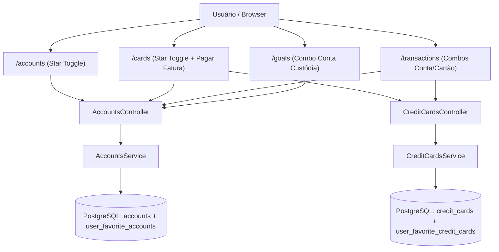

# Favoritar Contas e Cartões Design

**Spec**: `.specs/features/favorito-conta-cartao/spec.md`
**Context**: `.specs/features/favorito-conta-cartao/context.md`
**Status**: Approved

---

## Architecture Overview

A feature adiciona marcação individual de favoritos por usuário para contas bancárias (`Account`) e cartões de crédito (`CreditCard`), mantendo conformidade integral com as decisões arquiteturais ativas em `.specs/STATE.md`:

- **AD-001**: Arquitetura desacoplada NestJS (`/backend`) + Next.js (`/frontend`) + PostgreSQL via Prisma ORM.
- **AD-003 / AD-014**: Isolamento entre contexto pessoal e familiar, validação de acesso em todas as rotas e bloqueio estrito de mutações para membros `VIEWER` (`HTTP 403 ForbiddenException` no backend; ocultação de ações via `isViewer` no frontend).
- **AD-004**: Execução atômica via `prisma.$transaction` nas mutações compostas (`archive` e `remove`) ao limpar favoritos e atualizar o registro alvo.
- **AD-010**: Respeito ao soft delete (`deletedAt: null`) em todas as consultas e limpeza automática dos vínculos de favorito ao excluir logicamente.
- **AD-011**: Auditoria automática pelo `AuditLogInterceptor` global, que já mapeia rotas `/accounts/...` para `entityName: 'Account'` e `/credit-cards/...` para `entityName: 'CreditCard'` com `AuditAction.UPDATE` em requisições `PATCH`.
- **AD-030 / AD-031**: Padrão REST `PATCH /:id/favorite` e `PATCH /:id/unfavorite`, mantendo `GET /accounts` e `GET /credit-cards` retornando apenas itens ativos por padrão (`includeArchived=true` opcional).

### Abordagens Avaliadas para Persistência

| Opção | Estrutura | Trade-offs | Decisão |
| --- | --- | --- | --- |
| **Opção A (Recomendada)** | Duas tabelas de junção explícitas `user_favorite_accounts` e `user_favorite_credit_cards` com PK composta `(user_id, account_id)` e `(user_id, credit_card_id)` e `onDelete: Cascade` | Integridade referencial nativa no PostgreSQL, unicidade garantida em concorrência, zero polimorfismo e alinhamento direto com `TransactionTag` | **Escolhida** |
| **Opção B** | Tabela polimórfica única `user_favorites (user_id, entity_type, entity_id)` | Reduz 1 model no Prisma, mas perde chaves estrangeiras e cascade no banco | Descartada |



---

## Code Reuse Analysis

### Existing Components to Leverage

| Component | Location | How to Use |
| --- | --- | --- |
| `AccountsService.findById` / `verifyFamilyAccess` | `backend/src/modules/accounts/accounts.service.ts` | Reaproveitar checagem de existência (`deletedAt`), acesso pessoal/familiar e bloqueio de `VIEWER` |
| `CreditCardsService.findById` / `verifyFamilyAccess` | `backend/src/modules/credit-cards/credit-cards.service.ts` | Reaproveitar checagem de existência (`deletedAt`), acesso pessoal/familiar e bloqueio de `VIEWER` |
| `AuditLogInterceptor` | `backend/src/common/interceptors/audit-log.interceptor.ts` | Captura automaticamente `PATCH /accounts/:id/favorite|unfavorite` e `PATCH /credit-cards/:id/favorite|unfavorite` sem edição |
| `TransactionTag` pattern | `backend/prisma/schema.prisma` | Seguir convenção de PK composta `@@id([userId, ...])`, `@map(...)` e `onDelete: Cascade` |
| `useAuth().isViewer` & `apiRequest` | `frontend/src/context/AuthContext.tsx`, `frontend/src/lib/api.ts` | Ocultar botões de favorito para `VIEWER` e executar chamadas autenticadas `PATCH` |
| `lucide-react` (`Star`) | `frontend/src/app/accounts/page.tsx`, `frontend/src/app/cards/page.tsx` | Ícone padrão da UI para botão de favoritar/desfavoritar em cards ativos |

### Integration Points

| System | Integration Method |
| --- | --- |
| REST API Accounts | `GET /accounts`, `GET /accounts/:id`, `PATCH /accounts/:id/favorite`, `PATCH /accounts/:id/unfavorite`, `PATCH /accounts/:id/archive`, `PATCH /accounts/:id/unarchive`, `DELETE /accounts/:id` |
| REST API Credit Cards | `GET /credit-cards`, `GET /credit-cards/:id`, `PATCH /credit-cards/:id/favorite`, `PATCH /credit-cards/:id/unfavorite`, `PATCH /credit-cards/:id/archive`, `PATCH /credit-cards/:id/unarchive`, `DELETE /credit-cards/:id` |
| Database | Novas tabelas `user_favorite_accounts` e `user_favorite_credit_cards` com FKs para `users`, `accounts` e `credit_cards` |

---

## Components

### 1. Prisma Schema (`backend/prisma/schema.prisma`)

- **Purpose**: Persistir vínculos individuais de contas e cartões favoritos por usuário com garantia de unicidade e cascade.
- **Location**: `backend/prisma/schema.prisma`
- **Interfaces**: Modelos `UserFavoriteAccount` (`@@map("user_favorite_accounts")`) e `UserFavoriteCreditCard` (`@@map("user_favorite_credit_cards")`), além das relações inversas em `User`, `Account` e `CreditCard`.

### 2. `AccountsService` (`backend/src/modules/accounts/accounts.service.ts`)

- **Purpose**: Gerenciar leitura com `isFavorite` e ordenação `isFavorite DESC, createdAt DESC`, mutações idempotentes `favorite`/`unfavorite` e limpeza automática ao arquivar ou remover.
- **Location**: `backend/src/modules/accounts/accounts.service.ts`
- **Interfaces**:
  - `findAll(userId: string, familyId?: string, includeArchived?: boolean)` — mantém a chamada `prisma.account.findMany` inalterada (`orderBy: { createdAt: 'desc' }`). Quando retornar contas, busca os favoritos do `userId` via `prisma.userFavoriteAccount.findMany({ where: { userId, accountId: { in: ids } }, select: { accountId: true } })`, injeta `isFavorite: boolean` em cada item e ordena estavelmente colocando `isFavorite === true` antes de `false` (preservando `createdAt DESC` dentro de cada grupo).
  - `findById(userId: string, id: string)` — verifica acesso como hoje, consulta `prisma.userFavoriteAccount.findUnique({ where: { userId_accountId: { userId, accountId: account.id } } })` e retorna `{ ...account, isFavorite: Boolean(favorite) }`.
  - `favorite(userId: string, id: string)` — valida existência/acesso via `findById` (404/403), exige `verifyFamilyAccess(userId, account.familyId, true)` quando familiar (403 para `VIEWER`), bloqueia conta arquivada (`if (account.isArchived) throw new BadRequestException('Não é possível favoritar uma conta arquivada')`), executa `upsert` idempotente em `userFavoriteAccount` e retorna `{ ...account, isFavorite: true }`.
  - `unfavorite(userId: string, id: string)` — valida existência/acesso e escrita familiar (404/403), executa `deleteMany({ where: { userId, accountId: account.id } })` e retorna `{ ...account, isFavorite: false }`.
  - `archive(userId: string, id: string)` — dentro de `prisma.$transaction`, remove todos os favoritos da conta (`tx.userFavoriteAccount.deleteMany({ where: { accountId: account.id } })`) e arquiva a conta (`isArchived: true, isActive: false`), retornando `{ ...archived, isFavorite: false }`.
  - `unarchive(userId: string, id: string)` — retorna `{ ...reactivated, isFavorite: false }`.
  - `remove(userId: string, id: string)` — dentro de `prisma.$transaction`, remove todos os favoritos da conta (`tx.userFavoriteAccount.deleteMany({ where: { accountId: account.id } })`) e aplica soft delete (`deletedAt: new Date(), isActive: false`).

### 3. `AccountsController` (`backend/src/modules/accounts/accounts.controller.ts`)

- **Purpose**: Expor endpoints autenticados para favoritar e desfavoritar contas.
- **Location**: `backend/src/modules/accounts/accounts.controller.ts`
- **Interfaces**:
  - `@Patch(':id/favorite') favorite(@GetUser('id') userId: string, @Param('id') id: string)` → HTTP 200.
  - `@Patch(':id/unfavorite') unfavorite(@GetUser('id') userId: string, @Param('id') id: string)` → HTTP 200.

### 4. `CreditCardsService` (`backend/src/modules/credit-cards/credit-cards.service.ts`)

- **Purpose**: Gerenciar leitura com `isFavorite` e ordenação `isFavorite DESC, createdAt DESC`, mutações idempotentes `favorite`/`unfavorite` e limpeza automática ao arquivar ou remover.
- **Location**: `backend/src/modules/credit-cards/credit-cards.service.ts`
- **Interfaces**:
  - `findAll(userId: string, familyId?: string, includeArchived?: boolean)` — mantém `prisma.creditCard.findMany` inalterada (`orderBy: { createdAt: 'desc' }`). Quando houver cartões, consulta `prisma.userFavoriteCreditCard.findMany({ where: { userId, creditCardId: { in: ids } }, select: { creditCardId: true } })`, preserva cálculo de `committedAmount`/`availableLimit`, injeta `isFavorite: boolean` e ordena estavelmente com favoritos primeiro (`isFavorite DESC, createdAt DESC`).
  - `findById(userId: string, id: string)` — consulta `prisma.userFavoriteCreditCard.findUnique({ where: { userId_creditCardId: { userId, creditCardId: card.id } } })` e retorna `{ ...card, committedAmount, availableLimit, isFavorite: Boolean(favorite) }`.
  - `favorite(userId: string, id: string)` — valida existência/acesso via `findById` (404/403), exige `verifyFamilyAccess(userId, card.familyId, true)` quando familiar (403 para `VIEWER`), bloqueia cartão arquivado (`if (!card.isActive) throw new BadRequestException('Não é possível favoritar um cartão arquivado')`), executa `upsert` idempotente em `userFavoriteCreditCard` e retorna `{ ...card, isFavorite: true }`.
  - `unfavorite(userId: string, id: string)` — valida existência/acesso e escrita familiar (404/403), executa `deleteMany({ where: { userId, creditCardId: card.id } })` e retorna `{ ...card, isFavorite: false }`.
  - `archive(userId: string, id: string)` — dentro de `prisma.$transaction`, remove todos os favoritos do cartão (`tx.userFavoriteCreditCard.deleteMany({ where: { creditCardId: card.id } })`) e arquiva (`isActive: false`), retornando `{ ...archived, isFavorite: false }`.
  - `unarchive(userId: string, id: string)` — retorna `{ ...reactivated, isFavorite: false }`.
  - `remove(userId: string, id: string)` — dentro de `prisma.$transaction`, remove todos os favoritos do cartão (`tx.userFavoriteCreditCard.deleteMany({ where: { creditCardId: card.id } })`) e aplica soft delete (`deletedAt: new Date(), isActive: false`).

### 5. `CreditCardsController` (`backend/src/modules/credit-cards/credit-cards.controller.ts`)

- **Purpose**: Expor endpoints autenticados para favoritar e desfavoritar cartões de crédito.
- **Location**: `backend/src/modules/credit-cards/credit-cards.controller.ts`
- **Interfaces**:
  - `@Patch(':id/favorite') favorite(@GetUser('id') userId: string, @Param('id') id: string)` → HTTP 200.
  - `@Patch(':id/unfavorite') unfavorite(@GetUser('id') userId: string, @Param('id') id: string)` → HTTP 200.

### 6. Frontend Pages (`accounts`, `cards`, `transactions`, `goals`)

- **`frontend/src/app/accounts/page.tsx`**:
  - Em cards ativos (`!acc.isArchived`) e quando `!isViewer`, renderiza botão estrela (`Star` de `lucide-react`) ao lado de Arquivar/Excluir.
  - Estado `togglingFavoriteId` desabilita o botão durante a requisição `PATCH /accounts/${acc.id}/${acc.isFavorite ? 'unfavorite' : 'favorite'}` para evitar cliques duplos fora de ordem.
  - Recarrega lista via `loadAccounts()` ao concluir; em erro, preserva estado atual e exibe `alert`.
- **`frontend/src/app/cards/page.tsx`**:
  - Em cards ativos (`card.isActive !== false`) e quando `!isViewer`, renderiza botão estrela (`Star` de `lucide-react`) com `togglingFavoriteId` e chamada `PATCH /credit-cards/${card.id}/${card.isFavorite ? 'unfavorite' : 'favorite'}`.
  - No modal de Liquidação de Fatura (`select` de Conta de Débito), exibe opções como `${acc.isFavorite ? '★ ' : ''}${acc.name} (${formatCurrency(acc.currentBalance)})`.
- **`frontend/src/app/transactions/page.tsx`**:
  - Nos 5 combos do modal "Novo Lançamento Financeiro" (Conta Origem, Conta Destino, Despesa Conta, Despesa Cartão, Receita Conta), exibe o prefixo `'★ '` quando `isFavorite === true`, mantendo os itens já ordenados pelo backend com favoritos primeiro e pré-selecionando `accs[0]?.id` / `cds[0]?.id` (ou `''` quando vazio ao trocar de contexto).
- **`frontend/src/app/goals/page.tsx`**:
  - No combo "Conta Vinculada (Cofrinho)" do modal Nova Meta, exibe opções com `${acc.isFavorite ? '★ ' : ''}${acc.name} (${formatCurrency(acc.currentBalance)})` e atualiza a pré-seleção ao trocar de família.

---

## Data Models

```prisma
model UserFavoriteAccount {
  userId    String   @map("user_id") @db.Uuid
  accountId String   @map("account_id") @db.Uuid
  createdAt DateTime @default(now()) @map("created_at") @db.Timestamptz

  user      User     @relation(fields: [userId], references: [id], onDelete: Cascade)
  account   Account  @relation(fields: [accountId], references: [id], onDelete: Cascade)

  @@id([userId, accountId])
  @@index([accountId])
  @@map("user_favorite_accounts")
}

model UserFavoriteCreditCard {
  userId       String     @map("user_id") @db.Uuid
  creditCardId String     @map("credit_card_id") @db.Uuid
  createdAt    DateTime   @default(now()) @map("created_at") @db.Timestamptz

  user         User       @relation(fields: [userId], references: [id], onDelete: Cascade)
  creditCard   CreditCard @relation(fields: [creditCardId], references: [id], onDelete: Cascade)

  @@id([userId, creditCardId])
  @@index([creditCardId])
  @@map("user_favorite_credit_cards")
}
```

**Relationships**:
- `User` possui `favoriteAccounts UserFavoriteAccount[]` e `favoriteCreditCards UserFavoriteCreditCard[]`.
- `Account` possui `favoritedBy UserFavoriteAccount[]`.
- `CreditCard` possui `favoritedBy UserFavoriteCreditCard[]`.

```typescript
// Extensão do payload de resposta das APIs de Account e CreditCard
interface AccountWithFavorite extends Account {
  isFavorite: boolean;
}

interface CreditCardWithFavorite extends CreditCard {
  committedAmount: Prisma.Decimal;
  availableLimit: Prisma.Decimal;
  isFavorite: boolean;
}
```

---

## Error Handling Strategy

| Error Scenario | Handling | User Impact |
| --- | --- | --- |
| Conta ou cartão inexistente ou soft-deleted (`deletedAt != null`) | `NotFoundException` (`HTTP 404`) via `findById` | Endpoint retorna 404; UI exibe mensagem de erro |
| Favoritar item arquivado (`isArchived: true` ou `isActive: false`) | `BadRequestException` (`HTTP 400`) com mensagem exata da spec | Botão não é renderizado para arquivados; chamadas diretas à API recebem 400 |
| Usuário sem acesso ou com papel `VIEWER` na família | `ForbiddenException` (`HTTP 403`) via `findById` / `verifyFamilyAccess(..., true)` | Botão oculto para `VIEWER`; chamadas diretas retornam 403 sem alterar banco |
| Chamada repetida de favorite ou unfavorite (duplicada/concorrente) | `upsert` (favorite) e `deleteMany` (unfavorite) retornam `HTTP 200` com `isFavorite` final | Operação idempotente, sem erro 409/500 por race condition |
| Falha de rede ou HTTP no clique da estrela no frontend | Bloco `catch` mantém lista atual sem mutação otimista quebrada e exibe `alert` | Estado visual permanece consistente com o servidor |

---

## Risks & Concerns

| Concern | Location (file:line) | Impact | Mitigation |
| --- | --- | --- | --- |
| Worktree sem `node_modules` instalados inicialmente | `backend/package.json:1`, `frontend/package.json:1` | Comandos `jest`, `prisma` e `next` não executam até instalar dependências | Executar `npm ci` (ou `npm install`) em `backend/` e `frontend/` antes dos gates de execução |
| `CreditCardsService.remove` não valida `verifyFamilyAccess(userId, card.familyId, true)` para `VIEWER` (pré-existente) | `backend/src/modules/credit-cards/credit-cards.service.ts:234` | `VIEWER` poderia chamar `DELETE /credit-cards/:id` diretamente na API se não bloqueado | Fora do escopo desta feature (não alterar regra de remoção não solicitada; manter mudança cirúrgica na limpeza de favoritos dentro da remoção) |
| Testes unitários existentes fazem asserções `toEqual` exatas em `findAll`, `archive` e `unarchive` | `backend/test/unit/accounts.service.spec.ts:169`, `backend/test/unit/credit-cards.service.spec.ts:1150` | Adicionar `isFavorite` e `userFavorite*.findMany` no retorno quebraria testes se o mock `prisma.userFavorite*` e a expectativa do campo novo não forem atualizados juntos | Usar consulta separada `userFavorite*.findMany` sem alterar `prisma.*.findMany`, adicionar mocks padrão nos `beforeEach` das specs e atualizar apenas as expectativas do payload para contemplar `isFavorite` |
| `findById` chamado internamente por `update`/`archive`/`unarchive`/`remove` faz 1 consulta extra de favorito | `backend/src/modules/accounts/accounts.service.ts:82`, `backend/src/modules/credit-cards/credit-cards.service.ts:123` | Leve consulta `findUnique` por PK composta em operações pontuais | Impacto desprezível (busca por PK indexada); mantém única fonte de verdade para `findById` |

---

## Tech Decisions

| Decision | Choice | Rationale |
| --- | --- | --- |
| Estratégia de leitura dos favoritos | Consulta auxiliar em `userFavoriteAccount.findMany` / `userFavoriteCreditCard.findMany` após `findMany` principal, com ordenação estável em memória | Mantém contratos de query `prisma.account.findMany` e `prisma.creditCard.findMany` idênticos aos existentes e evita expor array interno `favoritedBy` na resposta JSON |
| Registro de decisão arquitetural | Registrar `AD-032` em `.specs/STATE.md` ao concluir a feature | Mantém histórico arquitetural atualizado para futuras features que consumam favoritos ou listas ordenadas |
