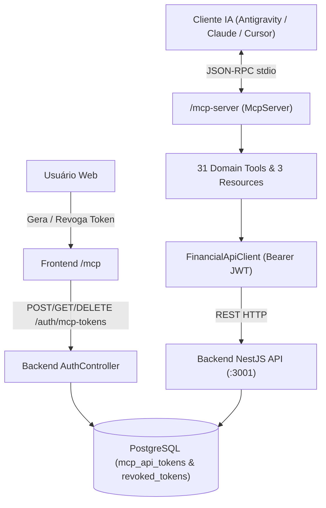

# MCP Server Design

**Spec**: `.specs/features/mcp-server/spec.md`
**Status**: Approved

---

## Architecture Overview

The solution consists of two cohesive parts that respect all active architectural decisions (`AD-001` through `AD-028`):

1. **Web Token Management (`/backend` + `/frontend`)**:
   - Adds the `McpApiToken` model in Prisma (`mcp_api_tokens` table) storing only the SHA-256 `tokenHash`, `tokenPrefix`, `name`, `expiresAt`, and `revokedAt`.
   - Extends `AuthService` and `AuthController` with `POST /auth/mcp-tokens`, `GET /auth/mcp-tokens`, and `DELETE /auth/mcp-tokens/:id`.
   - Integrates revocation with `TokenBlacklistService` so revoked tokens are immediately rejected by `JwtStrategy`.
   - Adds `/mcp` page in Next.js and a sidebar entry in `AppShell.tsx` to generate tokens, copy the pre-filled MCP JSON config, and revoke tokens.

2. **Dedicated MCP Server Package (`/mcp-server`)**:
   - Standalone TypeScript package using `@modelcontextprotocol/sdk` (`McpServer` + `StdioServerTransport`) and `zod`.
   - Uses `FinancialApiClient` to call the NestJS REST API (`http://localhost:3001`) with `Authorization: Bearer <MCP_API_TOKEN>` (or automatic login via `POST /auth/login` when email/password fallback is used).



---

## Code Reuse Analysis

### Existing Components to Leverage

| Component | Location | How to Use |
| --------- | -------- | ---------- |
| `AuthService` & `JwtService` | `backend/src/modules/auth/auth.service.ts` | Sign long-lived MCP JWTs and manage `McpApiToken` lifecycle |
| `TokenBlacklistService` | `backend/src/modules/auth/token-blacklist.service.ts` | Register revoked `tokenHash` in `revoked_tokens` and in-memory cache |
| `JwtStrategy` | `backend/src/modules/auth/jwt.strategy.ts` | Already validates Bearer tokens and checks `TokenBlacklistService.isBlacklisted` |
| `AppShell` | `frontend/src/components/layout/AppShell.tsx` | Add navigation link to `/mcp` using existing sidebar layout and `useAuth` context |
| `apiRequest` | `frontend/src/lib/api.ts` | Consume `/auth/mcp-tokens` endpoints from the new `/mcp` frontend page |

### Integration Points

| System | Integration Method |
| ------ | ------------------ |
| Backend REST API (`:3001`) | Consumed by `/mcp-server` over HTTP using native `fetch` and Bearer JWT |
| PostgreSQL (`mcp_api_tokens`) | Accessed via `PrismaService` inside `AuthService` |

---

## Components

### 1. Backend MCP Token Endpoints (`AuthService` & `AuthController`)

- **Purpose**: Issue, list, and revoke personal MCP API tokens for authenticated users.
- **Location**: `backend/src/modules/auth/`
- **Interfaces**:
  - `createMcpToken(userId: string, email: string, dto: CreateMcpTokenDto): Promise<CreatedMcpTokenResponse>`
  - `listMcpTokens(userId: string): Promise<McpTokenSummary[]>`
  - `revokeMcpToken(userId: string, tokenId: string): Promise<{ message: string }>`
- **Dependencies**: `PrismaService`, `JwtService`, `TokenBlacklistService`
- **Reuses**: `JwtAuthGuard`, `GetUser` decorator, SHA-256 hashing pattern from `TokenBlacklistService`.

### 2. Frontend MCP Integration Screen (`/mcp`)

- **Purpose**: Allow users to generate MCP tokens, copy the ready-to-use JSON config, and revoke existing tokens.
- **Location**: `frontend/src/app/mcp/page.tsx`
- **Interfaces**: Next.js App Router Client Component wrapped in `AppShell`.
- **Dependencies**: `apiRequest`, `useAuth`, `lucide-react`

### 3. MCP Config & HTTP Client (`config.ts` & `api-client.ts`)

- **Purpose**: Load MCP environment configuration, manage JWT bearer authentication / 401 retry, and execute typed HTTP requests against the backend API.
- **Location**: `mcp-server/src/config.ts`, `mcp-server/src/http/api-client.ts`
- **Interfaces**:
  - `loadConfig(env?: NodeJS.ProcessEnv): McpConfig`
  - `resolveFamilyId(explicitFamilyId: string | undefined, config: McpConfig): string | undefined`
  - `FinancialApiClient.request<T>(path: string, options?: ApiRequestOptions): Promise<T>`
  - `formatToolResult(data: unknown): CallToolResult`
  - `formatToolError(error: unknown): CallToolResult`

### 4. MCP Domain Tools & Resources (`mcp-server/src/tools/*.ts`)

- **Purpose**: Register 31 tools and 3 resources on `McpServer` mapped 1:1 to the backend controllers.
- **Location**:
  - `mcp-server/src/tools/context-tools.ts`
  - `mcp-server/src/tools/accounts-tools.ts`
  - `mcp-server/src/tools/transactions-tools.ts`
  - `mcp-server/src/tools/credit-cards-tools.ts`
  - `mcp-server/src/tools/budgets-goals-tools.ts`
  - `mcp-server/src/tools/reports-tools.ts`
  - `mcp-server/src/server.ts`

---

## Data Models

### Prisma Model: `McpApiToken`

```prisma
model McpApiToken {
  id          String    @id @default(uuid()) @db.Uuid
  userId      String    @map("user_id") @db.Uuid
  name        String    @db.VarChar(100)
  tokenHash   String    @unique @map("token_hash") @db.VarChar(64)
  tokenPrefix String    @map("token_prefix") @db.VarChar(24)
  expiresAt   DateTime  @map("expires_at") @db.Timestamptz
  lastUsedAt  DateTime? @map("last_used_at") @db.Timestamptz
  revokedAt   DateTime? @map("revoked_at") @db.Timestamptz
  createdAt   DateTime  @default(now()) @map("created_at") @db.Timestamptz

  user        User      @relation(fields: [userId], references: [id], onDelete: Cascade)

  @@index([userId, revokedAt])
  @@map("mcp_api_tokens")
}
```

---

## Error Handling Strategy

| Error Scenario | Handling | User Impact |
| -------------- | -------- | ----------- |
| Missing MCP credentials | `FinancialApiClient` throws descriptive configuration error caught by tool handler | Assistant explains how to generate `MCP_API_TOKEN` at `/mcp` |
| Backend HTTP `400` / `403` / `404` | `FinancialApiClient` parses NestJS `message` array/string into `ApiClientError` | Tool returns `isError: true` with exact business rule message (e.g. insufficient credit limit or `VIEWER` restriction) |
| Revoked or expired token (`HTTP 401`) | If using email/password fallback, retries login once; if using revoked `MCP_API_TOKEN`, returns `isError: true` | Assistant informs the user that the token is expired or revoked |

---

## Risks & Concerns

| Concern | Location (file:line) | Impact | Mitigation |
| ------- | -------------------- | ------ | ---------- |
| `TokenBlacklistService` stores revoked hashes by raw token string, whereas `McpApiToken` stores `tokenHash` | `backend/src/modules/auth/token-blacklist.service.ts:23` | When revoking a token by ID (`DELETE /auth/mcp-tokens/:id`), the server only has `tokenHash` from DB, not the raw token | Add `addHash(tokenHash: string, expiresAt: Date)` to `TokenBlacklistService` so revocation by DB `tokenHash` works without needing the raw token |
| Accidental `console.log` in MCP server corrupting JSON-RPC over `stdout` | `mcp-server/src/index.ts:1` | Breaks MCP client framing | Route all logging in `/mcp-server` exclusively to `process.stderr.write` / `console.error` |

---

## Tech Decisions

| Decision | Choice | Rationale |
| -------- | ------ | --------- |
| MCP SDK | `@modelcontextprotocol/sdk` + `zod` | Official TypeScript SDK with first-class `McpServer` and `StdioServerTransport` support |
| Token Revocation Mechanism | `McpApiToken` table + `TokenBlacklistService.addHash` | Reuses existing `JwtStrategy` blacklist check with zero overhead on valid requests |
